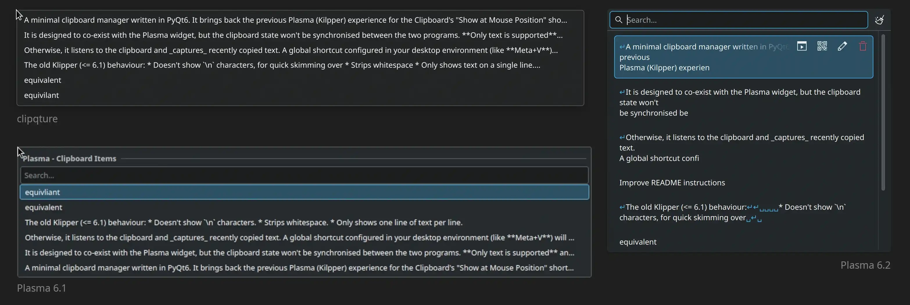

# Clipqture

A minimal clipboard written in PyQt6 for switching between text on the
clipboard via a simple context menu. It brings back the previous
Plasma 6.1 (Kilpper) experience for the Clipboard's "Show at Mouse Position" shortcut.

ClipQture = _**Clip**board for **Qt**/KDE desktops cap**ture** program._

It is designed to co-exist with the Plasma widget, although the clipboard state isn't
synchronised between the two programs (such as history)

Designed for KDE Plasma 6.8+ / Wayland only.

For X11 support, use the [v1.2.0 tag.](https://github.com/lah7/clipqture/tree/v1.2.0)

## Features

* Show window icon where text was copied from.
* Show previews of colour hex values (e.g. #RRGGBB).
* Configurable preferences file.

Note, the clipboard makes no attempt to hide sensitive data (e.g. passwords).

## Installation

### Arch / KDE

Grab a copy from [Releases]. Or, build a package using the supplied PKGBUILD:

    git clone https://github.com/lah7/clipqture.git
    makepkg -i

[Releases]: https://github.com/lah7/clipqture

Next, enable the **Clipqture** script in **System Settings** → Window Management →
**KWin Scripts**.

The shortcut can be changed in **System Settings** → Keyboard → Shortcuts.
(Disable Klipper's "Show Clipboard Items at Mouse Position" shortcut if it uses Meta+V.)

The program will be automatically started when you log in (`/etc/xdg/autostart`)

### Other Distributions & Environments

1. Make sure you have the [Python dependencies] installed.

2. Copy the files:

    * `clipqture.py` to `~/.local/bin/` (you may need to update your PATH)
    * `clipqture.desktop` to `~/.local/share/applications/`
    * `kwin/clipqture` to `~/.local/share/kwin/scripts/`

    Edit the `.desktop` files to adjust the path of the `Exec=` line to point
    to the full path where you placed `clipqture.py`.

3. Enable the KWin script (see above) and add `clipqture.py` to run at startup.

[wl-clipboard] must be installed.

[Python dependencies]: PKGBUILD#10
[wl-clipboard]: https://github.com/bugaevc/wl-clipboard

## Configuration

There are some basic settings to change with `~/.config/clipqture.conf`.
It will be created with default settings on the first run. Restart the program
to apply changes.

## Why does it exist?

Starting in Plasma 6.2.0, KDE's Klipper (Clipboard applet) went in a different
direction. The shortcut for _"Show Clipboard Items at Mouse Position"_ opens
the full widget at the cursor. I used it often enough that I missed the older version.

From a UI perspective, the widget has more buttons, more padding per item,
and buttons getting in the way. Context menus had a border, but the Plasma widget
does not (there's a shadow, but it's shallow, making it look flat).
Not to mention the widget takes up lots of vertical space that it may need
to scroll, and it has images and other data types I didn't need.

I was pretty happy and productive with the old menu, with one item per line.
This project brings back that simplicity. Other clipboard managers seemed too much.
Being written in Python, it's easy to modify and extend, and nobody can take
that away!

## Tip: Don't make your clipboard forget!

**It is recommended to keep Klipper enabled,** but disable the "show at cursor" shortcut.
This makes sure that the clipboard doesn't vanish if you copy text from a program
and then close that same program.

## License

[GNU General Public License v3.0](LICENSE)
